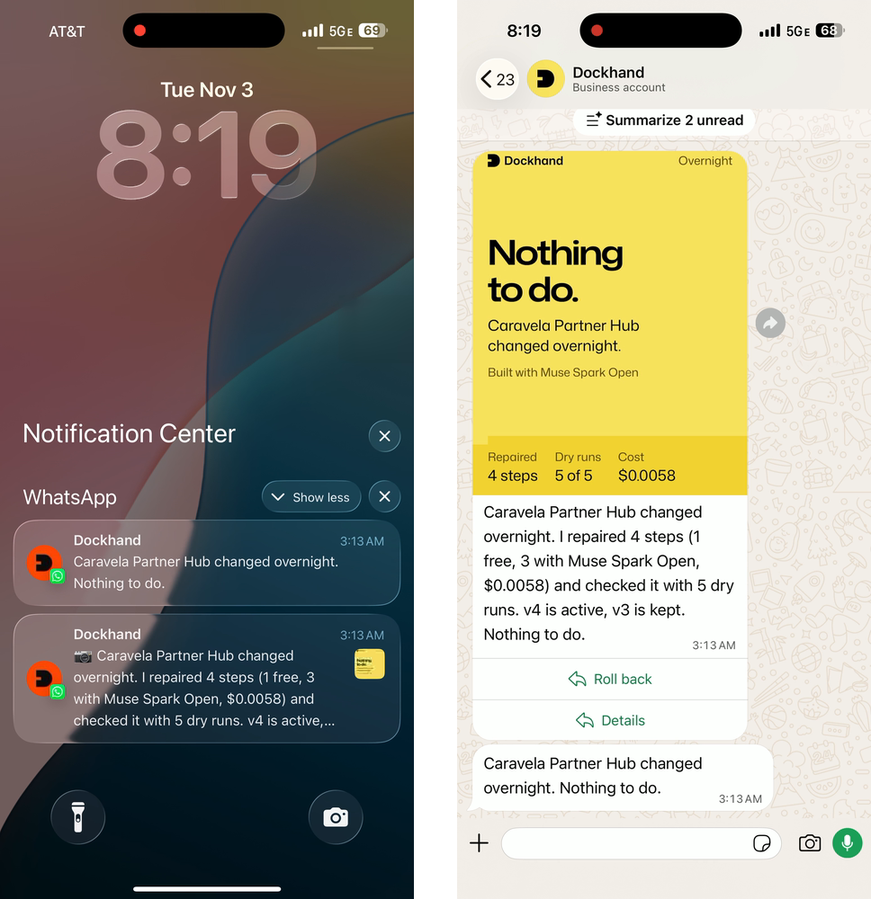
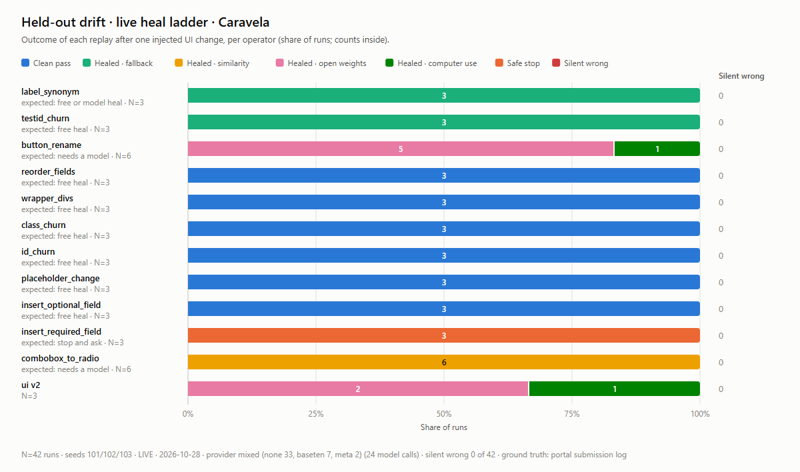
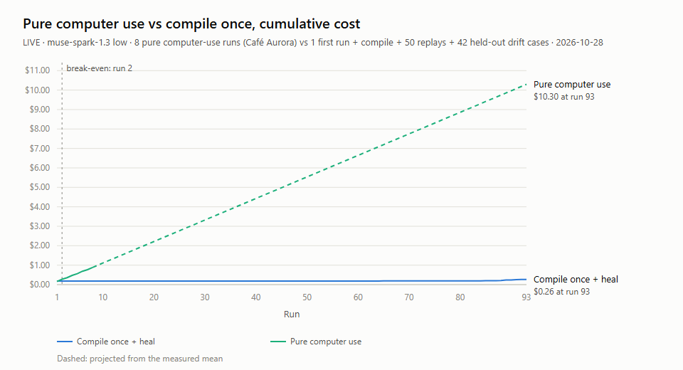

# Dockhand

**Automation that maintains itself.** Meta's computer use writes the program, every write is proven before it is submitted, and when the app changes the program repairs itself with the cheapest model that can, often before anyone notices.

<p align="center"></p>

<p align="center"><sub>3:13 AM, Nov 3: a scheduled change hit our partner portal overnight, and Dockhand repaired itself with nobody watching. Real phone, real WhatsApp, real model calls.</sub></p>

Show Dockhand a web workflow once, as a plain screen recording or just a goal. Muse computer use does it the first time and records exactly what it touched. That run compiles into a program that replays in seconds with no model calls. When the app's UI changes, a repair ladder fixes the broken step, verifies it, and saves a new version of the skill. A drift watch does the same with dry runs on a schedule, so the rep wakes up to "Caravela Partner Hub changed overnight. I repaired 4 steps (1 free, 3 with Muse Spark Open, $0.0058) and checked it with 5 dry runs. v4 is active, v3 is kept. Nothing to do." When the app needs information the program doesn't have, Dockhand asks the rep once and remembers the answer. Sales reps trigger, teach and approve everything from WhatsApp.

Built for the Meta Global AI Developer Hackathon (Indie track, "Build for Your World"). Everything in this repository was built during the event, Oct 27 to Nov 4, 2026. Engineered solo by Rabin with [Claude Code](https://claude.com/claude-code); the large first-day commits are whole packages built against the contracts frozen in the first hour (`93cea02`). MIT licensed.

## Why

In Brazil, India and much of LatAm and Southeast Asia, B2B deals move through WhatsApp: voice notes, photos of signed forms, PDFs from procurement. The follow-up work lands in web portals that give partners and suppliers a login, not an API: distributor deal registration, buyer supplier-onboarding portals, legacy CPQ. Reps retype the same data at night. Dockhand lets them forward the message instead.

## How it works

```
teach (video or goal) ─► draft ─► first run: Muse computer use ─► trace ─► compile + Muse Spark annotation ─► skill v1
                                                                                                            │
WhatsApp message ─► understand ─► plan ─► Approve ─► replay (0 model calls) ─► read back every field ─► Approve submit ─► receipt
                                                       │ a step no longer matches the page
                                                       ▼
            heal ladder: other stored selector ─► fingerprint similarity ─► Muse Spark Open ─► Muse computer use ─► ask the rep
                                                       │ fixed
                                                       ▼
                          canary dry runs ─► skill v(n+1) with a readable diff (old version kept for rollback)

drift watch (nightly, or /watch): dry run each skill, never submitting ─► broke? heal ladder ─► 5 canary dry runs ─► v(n+1) ─► "Nothing to do."
```

- **Teach from a video.** The recording is sent to WhatsApp as a document (no recompression). Muse Wonder turns it into a draft: steps that reference typed parameters by name, the submit control, and what success looks like. Values seen in the video are never typed into a real run.
- **First run with computer use.** Fixed 1280×800 viewport; before every click the harness re-checks the element under the pointer; every action is recorded with ranked selector candidates for the element it touched.
- **Compile.** The trace becomes a parameterized program built from end-state values, not keystrokes. Muse Spark writes step intents, parameter names and the success check; code verifies them, then the program must replay correctly twice in dry-run mode, once with the original values and once with fresh ones, before it is saved.
- **Replay.** No model calls. Before submitting, every filled value is read back from the page and compared with what the skill meant to write. Any mismatch stops the run.
- **Heal.** Cheapest rung first: another stored selector, fingerprint similarity (both free), Muse Spark Open picking the element from a pruned accessibility list (text only), Muse computer use with a narrow goal and at most 8 actions. When the page needs information the skill doesn't have, such as a new required field, Dockhand asks the rep once in WhatsApp and adds the parameter. A healed skill must pass canary dry runs before it is activated.
- **Maintain itself.** The drift watch replays every active skill in dry-run mode on a schedule (or on `/watch`), stopping before the submit control. A break is healed and canaried the same way, and the rep gets one card with the diff, Roll back and Details. A new required field is asked once; the answer becomes the parameter's default. Proactive cards outside WhatsApp's 24-hour window need an approved message template.

## Safety and approvals

- Nothing is submitted without a tap. The harness enforces this, not the model: a click or Enter on a submit control is blocked until the rep approves, and a network guard holds any POST, PUT, PATCH or DELETE to the portal until an approval exists. Writes and navigations to any other site are aborted.
- An approval releases exactly the control shown on its card: the harness clicks that element itself after checking it is still there, and voids the approval if the page changed. Approval cards show the filled form and the values read back from the page.
- Meta attaches a routine confirmation check to every computer-use action; the harness acknowledges that one by policy, since the gates above cover it. Any other safety check goes to the rep as an approval.
- Text taken from documents, photos and voice notes is cut to one line, length-capped and quoted as data before it reaches a model prompt.
- Only allow-listed reps can use it. Dockhand never messages buyers; it drafts replies for the rep to forward.

## Meta models, one job each

| Model | ID | Job |
|---|---|---|
| Muse Voice Transcribe | `muse-voice-transcribe-1.0` | Code-switched Portuguese/English voice notes |
| Muse Spark 1.3 | `muse-spark-1.3` | Reading photos and PDFs, understanding requests, annotating compiled skills, computer use (first runs and repairs) |
| Muse Wonder | `muse-wonder-1.0` | Turning a screen recording into a skill draft |
| Muse Spark Open | `meta-models/muse-spark-open` on Baseten Model APIs | Heal rung: picks the replacement element from the page's accessibility list, text only |

Every call is recorded in a ledger with tokens, images, latency and cost at Standard list prices. Receipts split intake cost (transcribing, reading) from execution cost.

Built with Muse Spark Open.

### What we found

Measured live; details and the full list in [`docs/research/meta-api-notes.md`](docs/research/meta-api-notes.md).

- **A screen recording is enough to teach a job.** From a 45-second recording, Muse Wonder wrote a draft with the steps, typed parameters (a country field became an enum of the 7 options visible in the video, the consent box a required boolean), the submit control and what success looks like: 20 s, $0.09.
- **Open weights do most of the repair work.** Muse Spark Open never sees a screenshot: it gets a pruned, text-only list of the page's elements and picks the new one in about 3 s for about $0.003. With the free fixes before it, 100 of 102 repairs needed no closed model.
- **Stateless computer use is 3 to 4 times faster.** The same turn took 9 to 11 s chained with `previous_response_id` and 2.4 to 3.2 s sent stateless with the receipts kept, so Dockhand replays a short window of turns itself.
- **Every acting computer call asks for confirmation.** Each one carries `computer_action_requires_confirmation`, even a scroll. Dockhand answers that one with its own gates (the rep's Approve tap, the commit and write guards) and sends any other safety check to the rep.
- **Computer use runs on Muse Spark 1.3.** On our key, Muse Wonder rejects the computer tool (HTTP 400), so first runs and repairs use Spark, and the ledger records the model that actually ran.

## Results

All live numbers are real Meta and Baseten calls at Standard list prices, measured Oct 28, 2026 on the mock portals, graded field by field against each portal's stored submission. Scripted and recorded (cassette) runs are never counted. Full summary: [`evals/results/live-headline.md`](evals/results/live-headline.md); raw rows in [`evals/results/live/`](evals/results/live/).

**The heal ladder on UI changes it never saw.** All 11 seeded mutation operators plus the v2 UI, on 3 held-out seeds (42 cases), against a skill compiled from a live first run:

- 42/42 correct: 39 submitted correctly after healing, 3 stopped safely on a new required field, **0 wrong writes**.
- Baseline on the same 42 cases (mock portal, no model calls, measured Oct 30): the skill's Playwright export run as a plain recorded script submitted 30 correctly and stopped on the other 12 (3 of them the required stop), and with one selector per step, as a codegen recording has it, it submitted 18 and stopped on 24; neither wrote wrong data ([section 4](evals/results/live-headline.md#4-baseline-an-ordinary-recorded-script-on-the-same-42-cases)).

| Rung | Steps tried | Healed | Cost per attempt | Latency per attempt |
|---|---|---|---|---|
| 1: other stored selector, fingerprint similarity | | 84 | $0 | |
| 2: Muse Spark Open (Baseten), text only | 18 | 16 (89%) | $0.0029 | 2.7 s |
| 3: Muse Spark 1.3 computer use, at most 8 actions | 2 | 2 (100%) | $0.0165 | 8.9 s |



**Computer use every time vs compile once.** Pure computer use was 8/8 correct at $0.111 and 145 s per run. Compiling once cost one first run and one annotation ($0.18), then 50/50 replays were correct with 0 model calls (3.9 s mean, randomized data, jittered portal latency), and the 42 drift cases above cost $0.084 in total. Over 93 runs: **$0.26 vs $10.30**; break-even at run 2. After the 8 measured runs, the pure computer-use line is projected from their mean (dashed on the chart).



| More live results | Model | Runs | Result |
|---|---|---|---|
| First run, supplier onboarding from a procurement PDF (multi-step, about 40 fields, 2 uploads), zero-shot | muse-spark-1.3, low effort | 3 | 3/3 correct, 40/40 fields each; 85–98 actions; 249–310 s; $0.32–$0.49 per run |
| That compiled skill replayed for a second buyer | none | 1 | 40/40 fields, 0 model calls, 4.8 s |
| First run guided by the teach video vs goal only (13-field form) | muse-spark-1.3, low effort | 8 and 3 | 8/8 and 3/3 correct; 34.6 vs 32.3 actions; $0.111 vs $0.118. No speed or cost advantage from the video on a form this size; what the video adds is the draft's named, typed parameters and its success check. |
| **Real software:** first run creating a lead in EspoCRM 10.0.11, unmodified (9 fields; then 11 with two dropdowns) | muse-spark-1.3, low effort | 3 and 1 | 3/3 at 9/9 fields, $0.02–$0.03 and 26–30 s each; 1/1 at 11/11, $0.087 |
| EspoCRM replay of the compiled skill | none | 1 | 11/11 fields, 0 model calls, 6.2 s |
| EspoCRM changed through its own admin screens (label renamed, layout reordered, new required field) | free rungs, then Muse Spark Open | 1 per change | Reorder healed free; rename + reorder healed by Muse Spark Open for $0.002; the new required field went to the rep; the healed version then replays the changed app with 0 heals in 8.3 s |

## What is real and what is simulated

| Real | Simulated |
|---|---|
| Every Meta model call (Responses API, native computer tool, Voice Transcribe, Muse Spark Open on Baseten) | The two portals: "Caravela Partner Hub" and a multi-tenant supplier portal, built for this project with fictional companies |
| WhatsApp Cloud API in the demo | All data: companies, people, documents (sample W-9 and insurance certificate in our own layouts) |
| HubSpot test portal writes | The WhatsApp emulator: development, tests, and the supplier shot in the film (its models were live) |
| EspoCRM 10.0.11, unmodified open-source CRM, changed only through its own admin screens | |
| The compiler, runner, heal ladder and evals | The scripted computer-use model, used only in CI; its runs never appear in reported model numbers |

## Run it

Requirements: Node 22.13+, pnpm 10, ffmpeg on PATH.

```bash
pnpm install
npx playwright install chromium
cp .env.example .env        # fake modes work without any keys
pnpm dev                    # gateway + WhatsApp emulator (/dev/chat) + both portals
pnpm test                   # unit, integration and end-to-end tests
pnpm run preflight          # checks keys, models, ffmpeg, Chromium, ports
```

Set `META_MODE=live`, `WHATSAPP_MODE=cloud` and `CRM_MODE=hubspot` with the keys in `.env` for the real setup.

```bash
pnpm demo:check                  # the whole demo through the app with Playwright, fake models, about 2.5 min
pnpm demo:check --mode cassette  # the same demo replaying recorded real Meta responses, no network, $0
pnpm tunnel                      # cloud mode: public tunnel to the gateway, re-registers the WhatsApp webhook
pnpm hubspot:seed                # fictional companies and deals in a HubSpot test account
DEMO_MODE=1 HEADLESS=false pnpm dev   # headed browser with the on-screen overlay (model, rung, read-back)
```

The flight recorder is at `http://localhost:8787/recorder` (local requests only). EspoCRM, the real third-party app, runs natively without Docker: `powershell -File apps/oss/espocrm/setup.ps1` once, then `start.ps1`, and set `ESPOCRM_URL=http://127.0.0.1:8090`; UI changes through its own admin are scripted in `scripts/oss/espocrm-drift.ts`.

## Repository

| Path | What |
|---|---|
| `packages/core` | Contracts, config, SQLite, artifacts, cost ledger |
| `packages/whatsapp` | Webhook parsing and signatures, Graph API client, emulator |
| `packages/meta` | Model gateway: structured output, files, transcription, computer use, open weights, cassettes |
| `packages/browser` | Browser pool, computer-use loop, trace capture, commit and write guards |
| `packages/skills` | Compiler, runner, read-back, heal ladder, versioning, Playwright export |
| `packages/orchestrator` | Intake, understanding, plans, approvals, flows, receipts, HubSpot, quotes |
| `packages/evals` | Synthetic cases, ground-truth scoring, charts |
| `apps/portals` | The two mock portals with seeded UI mutations |
| `apps/gateway` | The single dev process |

Design: [`docs/ARCHITECTURE.md`](docs/ARCHITECTURE.md).

## Third-party software

| Software | Version | License | How it is used |
|---|---|---|---|
| [EspoCRM](https://github.com/espocrm/espocrm) | 10.0.11 | AGPLv3 | The real third-party app Dockhand drives, unmodified. `apps/oss/espocrm/setup.ps1` downloads the official release into `var/oss/` (git-ignored); it is never committed. |
| PHP (Windows build) and MariaDB | 8.4.27, 11.4.13 | PHP License 3.01, GPLv2 | Portable runtimes for EspoCRM, downloaded by the same script, never committed. |
| [Mona Sans](https://github.com/github/mona-sans) and [Geist Mono](https://github.com/vercel/geist-font) | variable | SIL OFL 1.1 | The type in the WhatsApp cards, the on-screen overlay and the film; license in `packages/design/fonts/OFL.txt`. |

## Prior art

Record-and-replay with an agent fallback exists: browser-use's workflow-use records through its own recorder and falls back to an agent, and UiPath sells a Healing Agent for enterprise RPA. Dockhand's focus is different: teaching from an ordinary screen recording, a heal ladder measured per rung against UI changes it did not design, read-back verification so a heal can never silently write a wrong field, and asking the human when the app needs new information.
