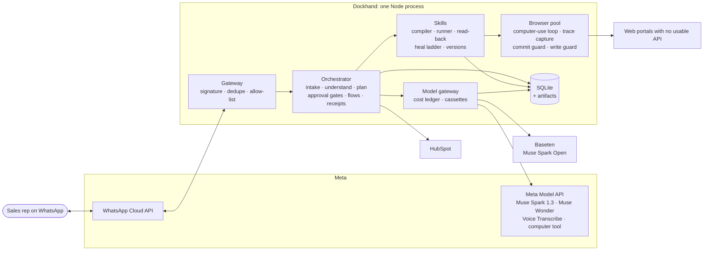
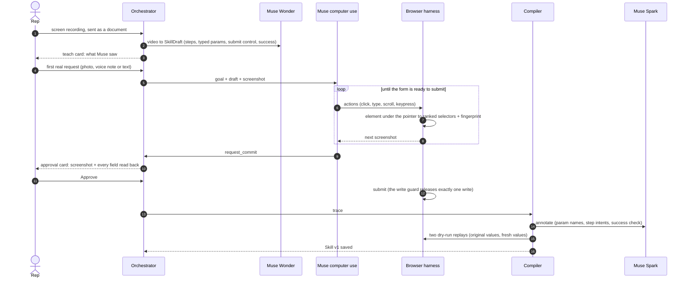
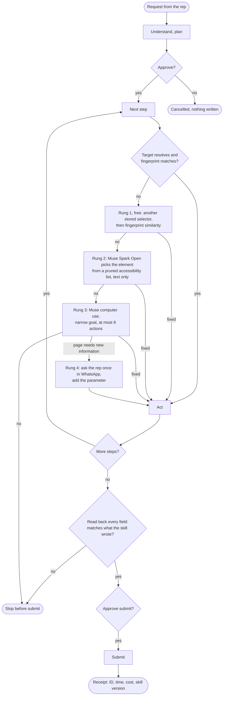
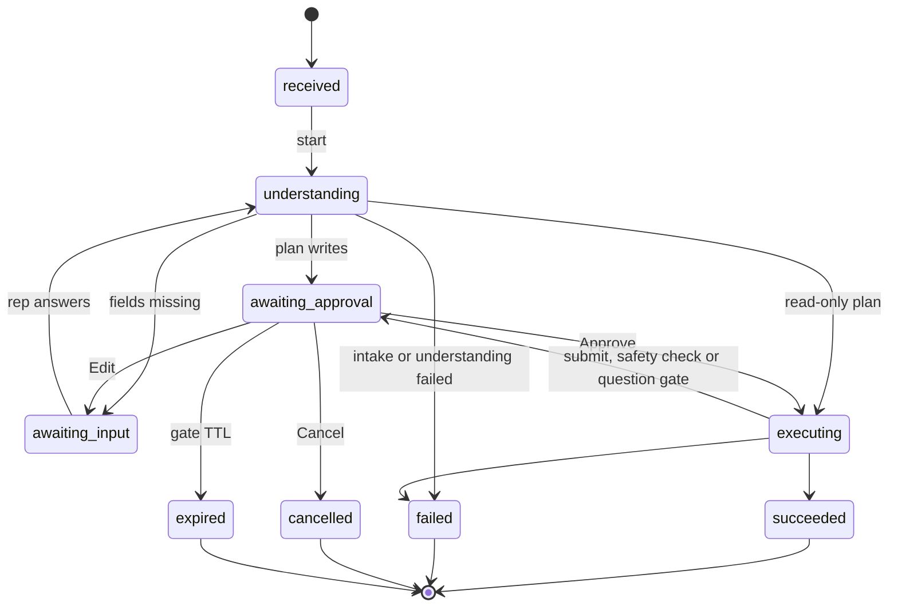
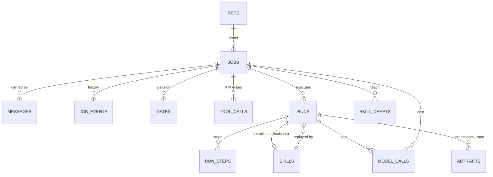

# Dockhand architecture

Dockhand learns a web workflow once, runs it the first time with Meta's computer use, compiles that run into a deterministic program, replays it in seconds, and repairs the program when the app's UI changes. Sales reps trigger, teach and approve everything from WhatsApp.

Contracts (every cross-package type) live in `packages/core/src/contracts/` and are the source of truth. This document explains the design around them.

## 0. System at a glance

The model is used where judgment is needed (reading a photo, understanding a request, doing a workflow the first time, repairing a step) and kept off the path once a workflow is known. A replay makes zero model calls; a step that breaks climbs a ladder that starts with free deterministic fixes and ends with asking the rep. A drift watch runs the same ladder on scheduled dry runs, so most breaks are repaired before a real request meets them (section 2.6).

## 1. Packages

| Package | Owns | May import |
|---|---|---|
| `packages/core` | Contracts; `loadConfig`, `openDb` (node:sqlite + `schema.sql`), `createArtifactStore`, `createLedger`, clocks, `ulid`, logger | zod |
| `packages/whatsapp` | Webhook parsing and signature check, the one `WhatsAppClient` (Graph API), and the emulator (a fake Graph API + `/dev/chat` page) | core |
| `packages/meta` | `ModelGateway`: Responses API (structured output, files, video), Voice Transcribe, live computer-use sessions, open-weights client (Baseten), cassette record/replay, fake gateway | core |
| `packages/browser` | Browser pool, computer-use loop, trace capture, commit guard, write guard, scripted CU model, `renderHtml` | core |
| `packages/skills` | Compiler, templates, runner (read-back, free heals), heal-ladder repairers, ask-rep, skill store, diff, Playwright export | core, browser |
| `packages/orchestrator` | Intake, understanding, `buildPlan`, job state machine, approval broker, flows, tools (CRM fake + HubSpot, quotes, receipts), teach pipeline | core, browser, skills |
| `packages/evals` | Case generators, suites, ground-truth scoring, charts, CLI | core, browser, skills, meta, portals |
| `apps/portals` | Mock portals: Caravela Partner Hub (v1/v2), multi-tenant supplier portal (acme, globex), seeded UI mutations, per-context sessions, ground-truth APIs | (standalone) |
| `apps/gateway` | One dev process: webhook routes, emulator, portals, wiring; `pnpm dev`, `pnpm run preflight`, `pnpm demo:check` | everything |

Rules: construction by injection (`createX(deps)`), no module-level state; plain JSON crosses package boundaries (Playwright `Page` is the one exception); anything crossing a process or model boundary has a zod schema.

## 2. The loop

### 2.0 Teach, first run, compile

### 2.0b Replay and heal

Every fix is verified by the harness before it is used (role and fingerprint for picked elements, then read-back for the whole form). After the run, a patched skill must pass canary dry runs before it is saved as v(n+1); the old version stays for rollback.

### 2.1 Teach
- Input: an mp4 sent as a WhatsApp video or document (documents avoid recompression; inbound media up to 100 MB). Audio, if present, is extracted with ffmpeg and transcribed separately (Spark 1.3 audio is not fully supported).
- `teach` call (Muse Wonder, Spark 1.3 fallback) returns a `SkillDraft`: goal, steps that reference params **by name**, typed params, the commit control's name, the success description. Values seen in the video go to `observedValues` for the rep's confirmation and are never sent to a run (otherwise the agent re-types the video's company).
- The draft is saved; the first real request for that portal runs agentically, guided by the draft; its trace compiles v1.

### 2.2 First run (computer use)
- Meta Responses API, native `computer` tool, plus function tools `request_commit`, `attach_file`, `propose_target`. Sessions are stateless (`store: false`, a bounded history resent each turn): measured live, a turn took 2.4–3.2 s this way and 9–11 s chained with `previous_response_id`. A turn slower than 40 s is sent once more.
- Fixed viewport 1280×800, device scale factor 1, `scale: 'css'` screenshots, scrollbars hidden; every screenshot is asserted to be exactly 1280×800.
- Each screenshot is paired with an element map. Before every click the harness re-resolves the element under the point; if it no longer matches what the batch intended, the batch stops.
- Batches also stop on URL change, `scrollY` change, or a new dialog.
- Trace capture before every action: `elementFromPoint` → nearest interactive ancestor → descriptor (accessible name from `ariaSnapshot`, label, testid, placeholder, section) → ranked candidates, keeping only candidates that resolve to exactly that element. Form values are snapshotted before every action so the compiler sees end states, not keystrokes.
- Commit guard (harness-enforced, not model-trusted): a click or Enter on a commit target without an approval token is not executed; the model is told to call `request_commit`. The approval card carries the screenshot and a read-back of every field.
- Write guard (network backstop): POST/PUT/PATCH/DELETE to the portal origin are held by `page.route` until a commit approval token exists; one token releases one write.
- Safety checks: Meta attaches `computer_action_requires_confirmation` to every acting turn, even a scroll, so the harness acknowledges that one code by policy (the rep approved the plan; the commit and write guards hold every write). Any other check code goes to the rep in WhatsApp as an approval; acknowledged checks are echoed.
- Actions are taken literally and checked: points outside the viewport are refused rather than clamped, scroll deltas sent in wheel notches are converted to pixels, and screenshots wait for smooth scrolling to settle.
- The resent history keeps a bounded number of screenshots (50-images-per-request cap). Long runs post a one-line progress update to WhatsApp about every 20 s.

### 2.3 Compile ("the model writes its own automation")
1. Deterministic normalization: drop noise (scrolls, moves, misclicks that changed nothing, focus clicks), merge click+type into `fill` using final field values, combobox open+option into `select`, file chooser into `upload`, navigations into `waitFor`.
2. Templating: values matched to params with formatters (dates, pt-BR numbers, phones, case, combobox option names, URL segments). Two params sharing a value is a warning.
3. Muse Spark `compile_annotate`: param names and descriptions, a plain-language `intent` per step (used by repair), the commit step, the success check and ID regex. The model proposes; code verifies.
4. Verification: the compiled skill is replayed in dry-run mode up to the commit step twice, once with the first run's values and once with fresh synthetic values, and must read back correctly both times. Otherwise it is not saved.

### 2.4 Replay
- Zero model calls on the happy path. Receipt text comes from templates; IDs from the compiled regex.
- Target resolution: strong candidates combined into one `or()` locator with one deadline, then a fingerprint similarity check on the matched element (role must match; label/name similarity above threshold). Disagreement between candidates escalates instead of trusting the top one.
- Read-back before commit: every filled, selected and checked value is read from the DOM and compared with what the skill meant to write. Any mismatch stops the run before the commit (`READBACK_MISMATCH`).
- Commit steps always pause for approval (eval auto-approve works only against localhost portals).
- If the success check times out after a commit, the outcome is `unknown` and the commit is never re-clicked.

### 2.5 Heal ladder
| Rung | Name in code | What | Cost |
|---|---|---|---|
| 1 | `fallback` | another stored candidate resolves uniquely and matches the fingerprint | free |
| 1 | `similarity` | fingerprint similarity over all interactive elements, with threshold and margin | free |
| 2 | `open_weights` | Muse Spark Open (Baseten) gets the step intent, the old fingerprint and a pruned accessibility list (text only) and picks the element; harness verifies | cents |
| 3 | `computer_use` | Muse computer use, narrow goal, ≤8 actions; commit steps run in `propose_only` mode (the harness clicks after approval) | dimes |
| 4 | `ask_rep` | the page requires information the skill has no param for (e.g. a new required field): ask once in WhatsApp, add the param, insert the step | a tap |

Validation errors from bad data are never sent to repair. A healed step is re-verified by continuing the run; a patched skill must pass canary dry-runs before it is activated. Evals never persist heals.

### 2.6 Drift watch (self-maintenance)
- Trigger: every `DRIFT_WATCH_EVERY_MIN` minutes, on the `/watch` command, or `POST /__dev/watch` (local only).
- Each active skill replays in dry-run mode on synthetic values (param defaults, first-run examples, company files). Every dry run, including compile verification and canaries, also resolves the submit control and heals it if it moved, without clicking it; the write guard holds every write.
- Outcomes:
  - Verified: recorded quietly.
  - Repaired: the heal ladder, then 5 canary dry runs, then v(n+1) is activated with the old version kept, and the rep gets one card (diff image, Roll back, Details).
  - New required field: asked once; the answer becomes the parameter's default, so later jobs don't ask again.
  - Can't heal safely: one line to the rep; the version stays and the next real job uses computer use for that step.
- Watch runs are tagged `drift_watch`; their model calls are attributed to the watch job in the ledger.
- WhatsApp only allows free-form messages within 24 hours of the rep's last message; a proactive card outside that window needs an approved template.

## 3. Orchestration
- Webhook: verify `X-Hub-Signature-256` over raw bytes, always 200 once verified, dedupe by wamid inside the job-creation transaction, ignore statuses, allow-list reps before any download or model call, download media immediately.
- Attach rule (no timers): a media message starts a new job; a reply to a Dockhand message attaches to that message's job; a text from a rep with a job awaiting input or a pending plan gate attaches to it.
- Understanding: one structured call returns a flat `Understanding`; `buildPlan()` is deterministic per intent.
- Gates: button ids `g:<gateId>:<a|r|e>`; gates have TTLs, late taps get a one-line reply; the boot sweep fails in-flight jobs and expires their gates.
- Browser leases have TTLs; at most 4 open contexts.
- Writes to external systems (HubSpot) record a `tool_calls` row before the HTTP call; POSTs are never auto-retried.
- Time: injected clock; rep time zone `America/Sao_Paulo`; params normalized (ISO dates, plain numbers) and formatted at fill time.

### 3.1 Job state machine

Every transition is a compare-and-set on `jobs.rev`, so a duplicate tap or a racing webhook cannot move a job twice.

Not drawn: `cancel` moves any non-terminal job to `cancelled`, and a crash recovered at boot moves it to `failed`.

## 4. Storage
- SQLite via `node:sqlite` (no native build): `var/dockhand.sqlite` for the app, `var/evals.sqlite` for evals. WAL, busy timeout, foreign keys. Schema in `packages/core/src/schema.sql`, migrated by `PRAGMA user_version` blocks that are only ever appended. `DOCKHAND_VAR_DIR` moves the whole data directory.
- Artifacts: content-addressed files under `var/artifacts/ab/<sha256>.<ext>`, written temp-then-rename; paths POSIX and relative to `var/`. The data dir is resolved from the workspace root, never from `cwd`.
- Screenshots: agentic runs keep every batch; replays keep failures and the final page; evals keep failures only.

`skills` is keyed by (name, version) with a unique partial index that allows exactly one active version per skill, so a rollback can never leave two versions active.

## 5. Models
| Job | Model |
|---|---|
| Voice notes (pt/en code-switching) | muse-voice-transcribe-1.0 (OGG/Opus → 16 kHz mono WAV via ffmpeg first) |
| Photo/PDF extraction, understanding, compile annotation | muse-spark-1.3, low effort |
| Teach from video | muse-wonder-1.0, medium effort |
| First-run computer use, rung 3 repair | muse-spark-1.3, low effort (measured; muse-wonder-1.0 answers HTTP 400 "Unsupported tool type: 'computer'") |
| Heal rung 2 | Muse Spark Open via Baseten (`meta-models/muse-spark-open`), reasoning effort low, JSON validated by us |

Every call goes through `ModelGateway` and lands in the `model_calls` ledger (provider, model, tokens, images, latency, cost at Standard list price). Receipts and charts split intake cost from execution cost. Scripted and cassette runs are labeled by provider and never appear in reported numbers.

## 6. Modes and safety
`META_MODE=live|record|cassette|fake`, `WHATSAPP_MODE=cloud|emulator`, `CRM_MODE=hubspot|fake`. Live modes fail at boot on missing secrets; the dev process prints a mode banner. Secrets only in `.env`. No request bodies or base64 images in logs.

## 7. Design decisions

| Decision | Why | Trade-off |
|---|---|---|
| Compile the first run into a program instead of re-running the agent | A known workflow should cost nothing and take seconds; a program is inspectable, diffable and versioned | Needs a repair path for UI change (section 2.5) |
| Selectors come from the live run, not from the video | Pixels in a recording can't tell you the DOM; the element under the pointer at click time gives testid, role, name and label candidates | The first real request is slower and costs model calls |
| Values are compiled from end states, not keystrokes | Typos, corrections and autocomplete make keystrokes unreliable; the final field value is what the portal stores | Needs a form snapshot before every action |
| Read back every field before every submit | A heal can match the wrong element; reading the DOM back turns that into a stop instead of a silent wrong write | One extra pass over the form per run |
| Approval is enforced by the harness and the network guard, not by the prompt | A model that misreads the screen must still be unable to submit | The model needs a `request_commit` tool and a harness note when blocked |
| Cheapest rung first | Most UI changes are renames and moves that free rungs fix; models are paid only for what they add | A ladder is more code than one agent call |
| Open weights for rung 2, text only | Picking one element from a pruned list is a small text task; it doesn't need screenshots or a frontier model | Its JSON isn't schema-enforced, so we validate it |
| Ask the rep when the page needs information the skill doesn't have | Guessing a required value is a silent wrong write | One extra tap for the rep |
| One process, SQLite, injected dependencies | Reliable demos, fast tests, no infrastructure to run | Not horizontally scalable as is |

## 8. Failure handling

| What goes wrong | What happens |
|---|---|
| WhatsApp redelivers a webhook | Dedupe on the message id inside the job-creation transaction; no second job |
| A rep taps a button twice or after it expired | Compare-and-set on the job; late taps get a one-line reply |
| The process restarts mid-job | The boot sweep fails in-flight jobs and expires their gates |
| A model returns invalid structured output | One retry, then `MODEL_INVALID_OUTPUT`; nothing is written |
| A step's target is gone | The heal ladder (section 2.5); if no rung fixes it, the run stops before any write |
| A page tries to send data elsewhere or navigate off the portal | Writes and main-frame navigations to any other origin are aborted and logged |
| The portal changes while nobody is using it | The drift watch finds it on a dry run, heals and canaries it, and tells the rep (section 2.6) |
| A field reads back wrong | `READBACK_MISMATCH`: the run stops before submit |
| The success page doesn't appear after submit | Outcome `unknown`; the submit is never clicked again |
| A HubSpot write fails | The `tool_calls` row is recorded first; POSTs are never auto-retried |

## 9. Conventions
- TypeScript, ESM, `tsx` (no build step), vitest, biome. Packages export `./src/index.ts`.
- The repo path contains a space: spawn processes with `execFile` and argument arrays, never shell strings.
- Tests: unit tests are pure and fast; integration tests use Playwright + portals on port 0 + the emulator + the scripted model; no pixel goldens (JSON/DOM goldens only); no sleeps (use `drain()` and `waitFor`).
- Synthetic data only. Fictional companies: Tidewater Cloud (us), Caravela (distributor), Acme Group and Globex Industrial (buyers).
