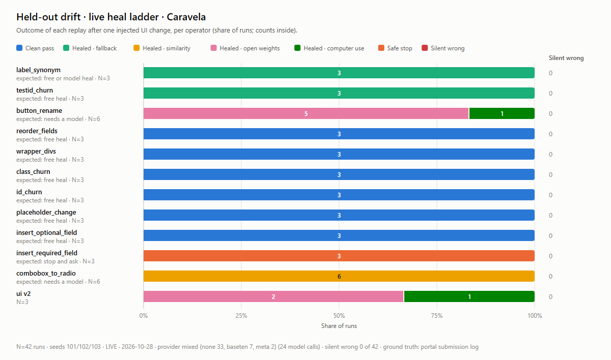
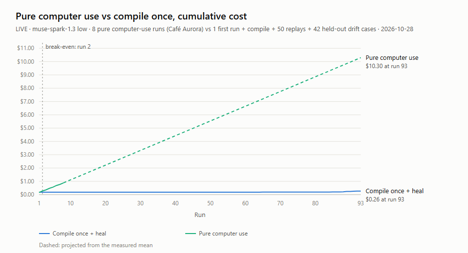
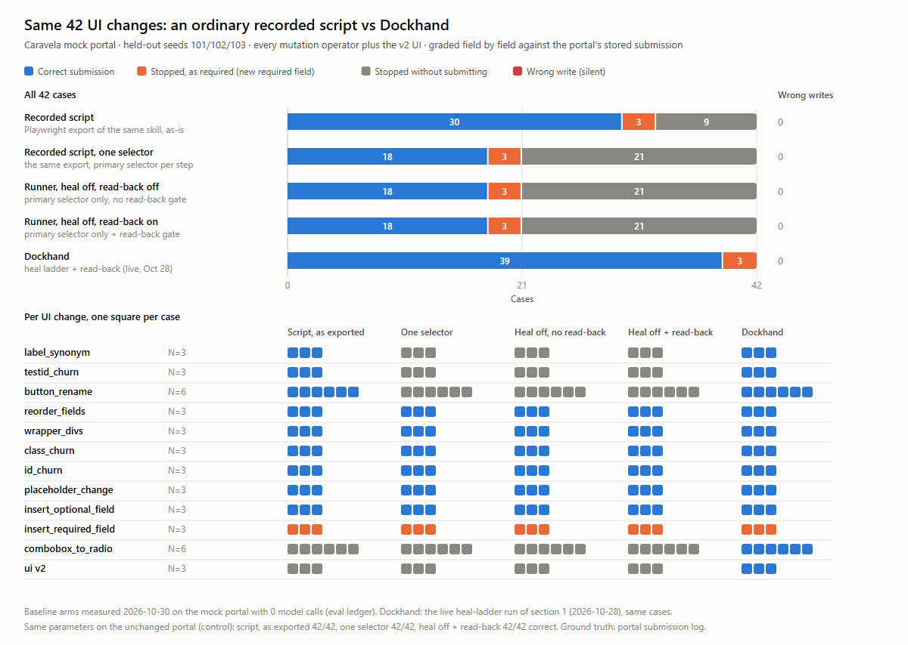

# Live headline evals (2026-10-28)

Real Meta and Baseten calls only (ledger providers meta/baseten); costs at Standard list price. Raw rows: `evals/results/live/`. Script: `scripts/live/headline.ts`.

## 1. Heal ladder on held-out drift (Caravela: every mutation operator, plus the v2 UI and the model-heal operators)
Seeds 101, 102, 103 (not used in development), 42 cases, compiled from a live first run. 42 correct, 0 false heals (silent wrong), must-fail-safe stopped 3/3, 0 failed without writing.

| Rung | Steps tried | Healed | Share | Cost per attempt | Latency per attempt |
|---|---|---|---|---|---|
| Free (fallback + similarity) | | 84 | | $0 | |
| 2: Muse Spark Open (Baseten, low) | 18 | 16 | 89% | $0.0029 | 2654 ms |
| 3: Muse Spark 1.3 computer use (low, ≤8 actions) | 2 | 2 | 100% | $0.0165 | 8910 ms |

Per operator (correct/cases): label_synonym 3/3, testid_churn 3/3, button_rename 6/6, reorder_fields 3/3, wrapper_divs 3/3, class_churn 3/3, id_churn 3/3, placeholder_change 3/3, insert_optional_field 3/3, insert_required_field 3/3, combobox_to_radio 6/6.

## 2. Pure computer use vs compile once
Pure computer use: 8/8 correct, $0.1107 and 145.2 s per run. Compile once: first run $0.1667 (same task, loop build before the harness-click fix 5b2164a) + annotation $0.0113 (dry runs 2/2), then 50/50 replays correct with 0 model calls (3875 ms mean, randomized params, jittered latency), then 42 drift cases (42 correct or safe stop, $0.0843). Over 93 runs: $0.262 vs $10.296 (pure computer use projected from its measured mean after run 8). Break-even at run 2.

## 3. Video-guided vs goal-only first run
| Arm | Runs | Correct | Mean actions | Mean cost | Mean time |
|---|---|---|---|---|---|
| Video-guided (live Wonder teach draft), first 3 | 3 | 3 | 36.3 | $0.1198 | 152.5 s |
| Video-guided, all | 8 | 8 | 34.6 | $0.1107 | 145.2 s |
| Goal only (no steps) | 3 | 3 | 32.3 | $0.1181 | 124.5 s |

## 4. Baseline: an ordinary recorded script on the same 42 cases
Same mock portal (Caravela), same held-out seeds (101, 102, 103), the same 42 cases (33 mutation + 9 repair, regenerated from the seeds with the headline's case date 2026-10-28; every case id and graded-field count matches section 1) and the same field-by-field grader against the portal's stored submission. No model calls: no model client is created and the eval ledger has 0 model-call rows. Measured 2026-10-30. Script: `scripts/evals/baseline.ts`; rows: `evals/results/baseline-recorded-script.json`.

| Arm | Correct submission | Stopped without submitting | Wrong write (silent) | Handled | Unchanged UI, same params (control) |
|---|---|---|---|---|---|
| Recorded script: the Playwright export, as-is | 30 | 12 (3 required) | 0 | 33/42 | 42/42 |
| Recorded script, one selector per step | 18 | 24 (3 required) | 0 | 21/42 | 42/42 |
| Dockhand runner, heal ladder off, read-back off | 18 | 24 (3 required) | 0 | 21/42 | – |
| Dockhand runner, heal ladder off, read-back on | 18 | 24 (3 required) | 0 | 21/42 | 42/42 |
| Dockhand: heal ladder + read-back (section 1, live) | 39 | 3 (3 required) | 0 | 42/42 | – |

Handled = a correct submission, or a stop where stopping is required (the new required field; guessing it would be a wrong write). Required stops are counted in the stopped column.

Method. Recorded script: `exportPlaywright` (packages/skills) of the same compiled v1 skill, run as-is in a fresh browser per case with Playwright's default 30 s timeouts: no healing, no read-back, no approval gate. Each exported step tries its stored selectors in rank order (test id, role, label, CSS, placeholder), which is more forgiving than a codegen recording, so the second row runs the same export cut to each step's primary selector (test id for most steps; role and name for the two dropdowns and the consent checkbox). Optional values a case leaves out are passed as empty strings. Runner rows: the same v1 program in Dockhand's runner with the primary selector only and the heal ladder off (no similarity, no widget swap, no repair models, no rep answers); they differ only in the read-back gate before the submit. Dockhand: the live rows of section 1, not re-run.

Read-back alone: with the heal ladder off, no case wrote a wrong value even without the read-back gate (0 wrong writes with the gate off, 0 with it on), so on these cases it had nothing to prevent. Every baseline failure was a stop where a recorded selector or dropdown option no longer matched; none submitted wrong data.

| UI change | Cases | Script, as exported | One selector per step | Heal off, read-back off | Heal off, read-back on | Dockhand |
|---|---|---|---|---|---|---|
| label_synonym | 3 | 3 correct | 3 stopped (s8 Country ×3) | 3 stopped (s8 Country ×3) | 3 stopped (s8 Country ×3) | 3 correct |
| testid_churn | 3 | 3 correct | 3 stopped (s2 Go to deal registrations ×3) | 3 stopped (s2 Go to deal registrations ×3) | 3 stopped (s2 Go to deal registrations ×3) | 3 correct |
| button_rename | 6 | 6 correct | 6 stopped (s4 Register a deal ×6) | 6 stopped (s4 Register a deal ×6) | 6 stopped (s4 Register a deal ×6) | 6 correct |
| reorder_fields | 3 | 3 correct | 3 correct | 3 correct | 3 correct | 3 correct |
| wrapper_divs | 3 | 3 correct | 3 correct | 3 correct | 3 correct | 3 correct |
| class_churn | 3 | 3 correct | 3 correct | 3 correct | 3 correct | 3 correct |
| id_churn | 3 | 3 correct | 3 correct | 3 correct | 3 correct | 3 correct |
| placeholder_change | 3 | 3 correct | 3 correct | 3 correct | 3 correct | 3 correct |
| insert_optional_field | 3 | 3 correct | 3 correct | 3 correct | 3 correct | 3 correct |
| insert_required_field | 3 | 3 stopped as required | 3 stopped as required | 3 stopped as required | 3 stopped as required | 3 stopped as required |
| combobox_to_radio | 6 | 6 stopped (s13 Product ×6) | 6 stopped (s13 Product ×6) | 6 stopped (s13 Product ×6) | 6 stopped (s13 Product ×6) | 6 correct |
| ui v2 | 3 | 3 stopped (s13 Product ×3) | 3 stopped (s2 Go to deal registrations ×3) | 3 stopped (s2 Go to deal registrations ×3) | 3 stopped (s2 Go to deal registrations ×3) | 3 correct |

Why Dockhand paid for a model on `button_rename` where the exported script clicked for free: after a rename only the button's test id still matches, and Dockhand does not accept one matching attribute on its own, because a test id moved onto another control would pass the same check (`fingerprintCheck` in `packages/browser/src/helpers/resolve.ts`). A model confirms the renamed button first. The exported script clicks whatever carries the id.

## 5. Runs not counted, and why

Three files in `live/` hold first runs that the tables leave out. Counting them, 14 of the 15 video-guided first runs submitted all 13 fields correctly.

| File | Runs | Result | Why it is not in the tables above |
|---|---|---|---|
| `discarded-shared-portal-firstrun-caravela-video-2026-10-28.jsonl` | 3 | 2 at 13/13, 1 at 0/13 | The runs shared one portal session, so they were not independent. The second run opened on the first run's confirmation page (NW-REG-48213), reported it after 2 actions and was graded 0/13. |
| `discarded-orphan-process-firstrun-caravela-video-2026-10-28.jsonl` | 1 | 13/13 | Made while a stray process from an interrupted run was still running. |
| `prefix-commitclick-firstrun-caravela-video-2026-10-28.jsonl` | 3 | 3 at 13/13 | An earlier build of the computer-use loop, before the harness-click fix (5b2164a). Section 2 compiles from the first of these. |

