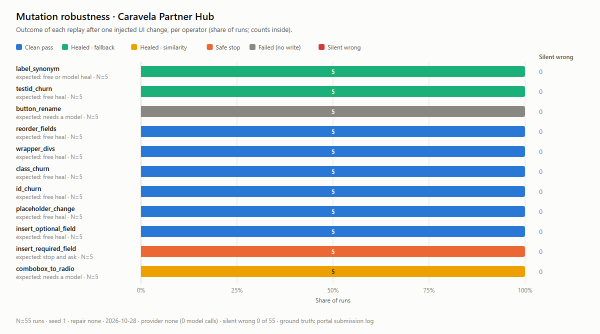
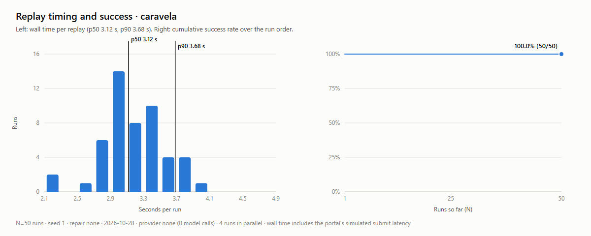
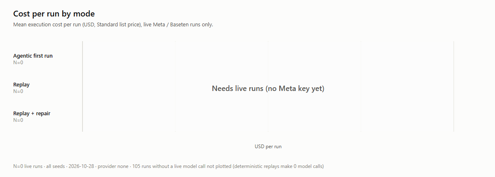

# Dockhand eval results

**Silent wrong: 0 of 105 runs** (a submission with any wrong field; the number that must stay at 0).

Generated 2026-10-28T05:35:39.740Z. Ground truth is each portal's own submission log. Scripted and fake runs are labeled by provider and never reported as agentic or first runs.

## Runs

- mutation · caravela_register_deal · seed 1 · repair none · provider none · N=55: correct 50/55 (90.9%: 45 right submissions + 5 required safe stops) · silent wrong 0 · safe stops 5 · failed 5 · heals fallback 10 runs (73 steps), similarity 5 runs (5 steps) · p50 3.88 s, p90 5.88 s · 0 model calls, $0.0000/run
- replay · caravela_register_deal · seed 1 · repair none · provider none · N=50: correct 50/50 (100.0%) · silent wrong 0 · safe stops 0 · failed 0 · heals none · p50 3.12 s, p90 3.68 s · 0 model calls, $0.0000/run

## mutation by change · caravela_register_deal · seed 1 · repair none · provider none · N=55

| Change | Expected | N | Clean | Healed | Safe stop | Failed | Silent wrong |
|---|---|---|---|---|---|---|---|
| label_synonym | free or model heal expected | 5 | 0 | 5 fallback | 0 | 0 | 0 |
| testid_churn | free heal expected | 5 | 0 | 5 fallback | 0 | 0 | 0 |
| button_rename | needs a model rung | 5 | 0 | 0 | 0 | 5 | 0 |
| reorder_fields | free heal expected | 5 | 5 | 0 | 0 | 0 | 0 |
| wrapper_divs | free heal expected | 5 | 5 | 0 | 0 | 0 | 0 |
| class_churn | free heal expected | 5 | 5 | 0 | 0 | 0 | 0 |
| id_churn | free heal expected | 5 | 5 | 0 | 0 | 0 | 0 |
| placeholder_change | free heal expected | 5 | 5 | 0 | 0 | 0 | 0 |
| insert_optional_field | free heal expected | 5 | 5 | 0 | 0 | 0 | 0 |
| insert_required_field | must stop and ask | 5 | 0 | 0 | 5 | 0 | 0 |
| combobox_to_radio | needs a model rung | 5 | 0 | 5 similarity | 0 | 0 | 0 |

## Charts

